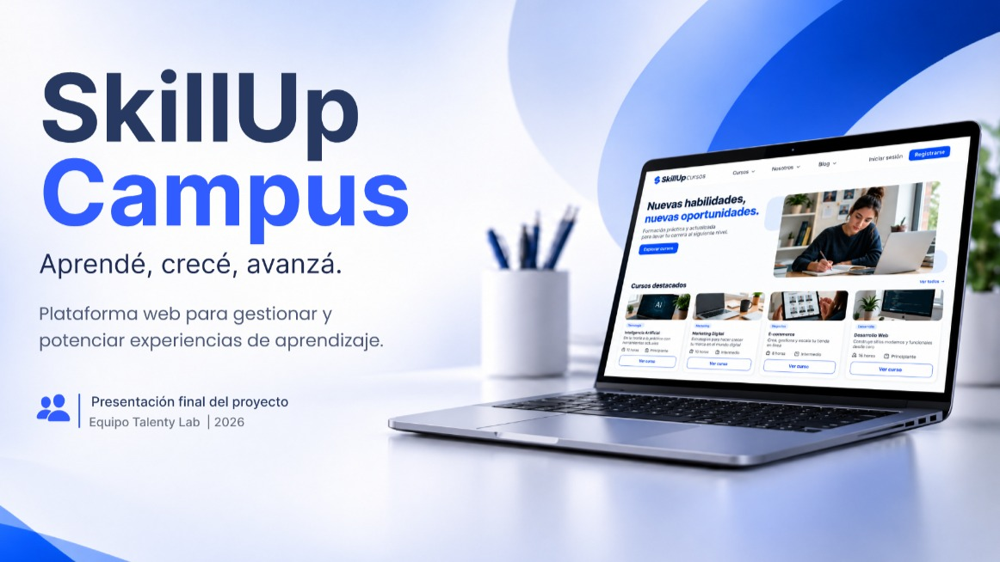

# 🚀 SkillUp Campus - Plataforma Web EdTech (MVP)

¡Bienvenidos a **SkillUp Campus**! Este repositorio contiene el desarrollo de una solución tecnológica diseñada para transformar la gestión operativa de una startup de educación tecnológica (EdTech) en pleno crecimiento.

El proyecto simula un entorno de desarrollo real y profesional, abordando desde la investigación de usuarios y diseño UX/UI, hasta la programación, pruebas de calidad (QA) y gestión ágil del producto en un plazo estricto de 8 semanas.

---

## 📄 El Problema y Nuestra Misión

### El Desafío de Negocio
Actualmente, SkillUp Campus gestiona la administración de sus alumnos y cursos de manera 100% manual utilizando planillas de Excel, correos electrónicos sueltos y formularios aislados. Este flujo operativo genera desorganización interna, lentitud en los procesos y una experiencia de usuario final con alta fricción.

### Nuestra Misión
Diseñar, programar, testear y preparar el lanzamiento de una plataforma web funcional y centralizada que digitalice toda la operación. El enfoque principal del equipo está puesto en entregar un Producto Mínimo Viable (MVP) que sea simple, intuitivo y altamente estable.

---

## 🎯 Alcance del Proyecto (MVP)

Para maximizar el valor entregado en 8 semanas, el desarrollo se concentra en la funcionalidad principal del negocio, dejando fuera de esta fase optimizaciones extremas o integraciones complejas (como pasarelas de pago reales, streaming nativo o chats).

### 👥 Para Usuarios (Estudiantes)
* **Autenticación:** Registro de cuenta e inicio de sesión seguro.
* **Catálogo de Cursos:** Vista pública con la oferta educativa disponible.
* **Inscripción:** Flujo ágil para anotarse en los cursos.
* **Panel Personal:** Área privada del estudiante para acceder a sus clases.

### 💼 Para Administradores
* **Gestión de Usuarios:** Control básico de los perfiles registrados en la plataforma.
* **Panel de Control (CRUD):** Interfaz exclusiva para Crear, Leer, Actualizar y Borrar cursos de la base de datos de forma dinámica.

---

## 🌟 El Equipo y Roles Profesionales

Este proyecto es el resultado del trabajo colaborativo de un equipo multidisciplinario. A continuación, puedes conocer a los integrantes, sus roles y sus redes profesionales:

|                                        Foto                                         | Nombre | Rol | Redes Profesionales | Contribución Clave en el Proyecto |
|:-----------------------------------------------------------------------------------:| :--- | :--- | :---: | :--- |
|                | **Julieta Di Cesare** | UX/UI Designer | [LinkedIn](https://www.linkedin.com/in/julieta-di-cesare-412602383/) [GitHub](https://github.com/julietadicesare31) | Investigación de usuarios y diseño de una experiencia de aprendizaje sin fricciones en Figma. |
|         | **Sabrina Ojeda** | Frontend Developer | [LinkedIn](https://www.linkedin.com/in/sabrinaojeda22/) [GitHub](https://github.com/dreams2023) | Maquetación responsiva, lógica de interfaces y consumo de contratos de API. |
|             | **David Pérez** | Frontend Developer | [LinkedIn](https://www.linkedin.com/in/david-p%C3%A9rez-0549b32ab/) [GitHub](https://github.com/Dalepp888) | Maquetación responsiva, lógica de interfaces y consumo de contratos de API. |
|      | **Yusleidy Gamboa** | Backend Developer | [LinkedIn](https://www.linkedin.com/in/yusleidy-gamboa-914299196) [GitHub](https://github.com/Yusleidy20) | Arquitectura de la API, modelado de la base de datos y control de accesos (Roles/Permisos). |
|                  | **Alexis Rodriguez** | Backend Developer | [LinkedIn](https://www.linkedin.com/in/alexisrodriguezar/) [GitHub](https://github.com/alexisrodriguezar) | Arquitectura de la API, modelado de la base de datos y control de accesos (Roles/Permisos). |
|  | **María Jimena Quintana** | QA Tester | [LinkedIn](https://www.linkedin.com/in/maria-jimena-quintana-qa-manual-automation/) [GitHub](https://github.com/Xime011) | Diseño de planes de prueba y validación de seguridad (ej. asegurar que el rol Estudiante no acceda al CRUD). |
|        | **Nicolás Toloza** | Project Manager | [LinkedIn](https://www.linkedin.com/in/nicolas-toloza/) [GitHub](https://github.com/NickTolz) | Planificación del roadmap de 8 semanas, priorización del backlog y metodologías ágiles. |

---

## 🔗 Enlaces del Proyecto

* 🎨 **Prototipo e Investigación UX/UI (Figma):** [Ver Diseño en Figma](https://www.figma.com/design/9Q9xHbMtepCbuJIDsXA9JK/SkillUp?node-id=226-991&p=f)
* 🚀 **Aplicación en Producción (Demo en Vivo):** [Ver Aplicación Desplegada](https://skillup-workspace.pages.dev/)

---

## 📂 Estructura del Repositorio y Guía Técnica

Si eres un perfil técnico y quieres revisar a fondo nuestro código o levantar el proyecto en tu entorno local, puedes dirigirte a las guías específicas de cada componente:

* 💻 **[Documentación de Frontend](./frontend):** Consulta el [README de Frontend](./frontend/README.md) para ver los comandos de instalación de dependencias (`npm`) y ejecución de la interfaz.
* ⚙️ **[Documentación de Backend](./backend):** Consulta el [README de Backend](./backend/README.md) para conocer la configuración de variables de entorno, la inicialización del servidor y la base de datos.